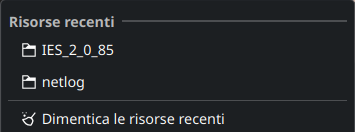

# vscode-recent-workspaces-linux

[](https://github.com/intilinux-eng/vscode-recent-workspaces-linux/actions/workflows/tests.yml)

Recent VS Code folders and workspaces in the **taskbar icon menu on Linux**, like the Windows Jump List.

Right-click the VS Code icon in the KDE Plasma task manager and your recently opened projects show up under **Recent**. Click one to open VS Code on it.



## Why

VS Code publishes recent workspaces to the Windows Jump List and to the macOS dock, but **on Linux it publishes nothing**: Electron's `app.addRecentDocument()` is a no-op there. This tool fills the gap until native support lands upstream. It does exactly what a native implementation would do, so it doubles as a field test for that proposal.

## How it works

1. It reads VS Code's own list of recent items (*File → Open Recent*), stored in `~/.vscode-shared/sharedStorage/state.vscdb`, and keeps local folders and workspaces. Remote and deleted ones are skipped.
2. It records each **newly opened** entry in the freedesktop.org recently-used registry, `~/.local/share/recently-used.xbel`, through GLib's `GBookmarkFile`. Each entry is attributed to VS Code's `.desktop` file:
   - `name` = desktop ID (e.g. `com.microsoft.VSCode`);
   - `exec` = the **exact** `Exec=` line of that file, resolved with `GDesktopAppInfo`. KDE requires the exact match: an entry with a different `exec` is attributed to another app.
3. KDE's activity manager (`kactivitymanagerd`) imports the registry, and the Plasma task manager lists up to 5 recent items per app.

A systemd user `.path` unit watches VS Code's storage file and runs a sync when it changes. There is no background process.

Some details:
- Only entries opened since the last run are recorded. Plasma takes the time of each event from when it reads the registry, so re-adding everything would scramble the order.
- Removing an entry from VS Code's recent list also removes it from the registry and from Plasma's stats.
- Other applications' registrations are never touched: only VS Code's own `<bookmark:application>` element is added or removed.

## Requirements

- Python 3.9+ and PyGObject (`python3-gi` on Debian/Ubuntu)
- systemd user session
- KDE Plasma to see the menu. Other desktops still get the entries in `recently-used.xbel`, for example in GTK file choosers.

## Install

```sh
git clone https://github.com/intilinux-eng/vscode-recent-workspaces-linux
cd vscode-recent-workspaces-linux
./install.sh
```

Open a folder in VS Code, then right-click its icon in the task manager. VS Code writes its recent list to disk lazily, so a new entry can take a little while to appear.

## Usage

```sh
vscode-recents status      # detected .desktop file, Exec line, VS Code MRU and published entries
vscode-recents sync -v     # what the systemd unit runs
vscode-recents --dry-run   # show what a sync would do
vscode-recents clear       # unregister everything this tool published
```

Options:

| Option | Default | |
|---|---|---|
| `--desktop-id` | autodetect: `com.microsoft.VSCode`, `code`, `code_code` (Snap), `com.visualstudio.code` (Flatpak) | VS Code's `.desktop` file |
| `--storage` | `~/.vscode-shared/sharedStorage/state.vscdb` | VS Code's shared storage DB |
| `--max` | `10` | entries to publish |

Tested with the Microsoft `.deb` on Kubuntu 26.10, Plasma 6.7.5. For Snap, Flatpak or VSCodium, pass `--desktop-id` and `--storage` if autodetection doesn't find them. Reports are welcome.

## Uninstall

```sh
./uninstall.sh
```

## Tests

```sh
python3 -m unittest discover -s tests -v
```

The tests run in a temporary XDG environment and never touch your real registry, VS Code data or KDE stats.

`tools/xbel_probe.py` reproduces the KDE behaviour by hand. It registers one path the way a native implementation would, then prints the agent `kactivitymanagerd` recorded for it:

```sh
tools/xbel_probe.py ~/Projects/foo                                    # Exec from the .desktop file -> attributed to VS Code
tools/xbel_probe.py ~/Projects/bar --exec "/usr/share/code/code %u"   # mismatching Exec -> attributed to "/usr/share/code/code"
tools/xbel_probe.py ~/Projects/foo --remove                           # removes only VS Code's registration
```

## Upstream

The goal is native support, tracked in **[microsoft/vscode#348335](https://github.com/microsoft/vscode/issues/348335)**:
1. **Electron**: implement `app.addRecentDocument()` / `clearRecentDocuments()` on Linux with `GBookmarkFile`.
2. **VS Code**: record opened workspaces on Linux.
3. **KDE**: let `kactivitymanagerd` fall back to the XBEL `name` attribute when `exec` doesn't match.

## License

MIT
